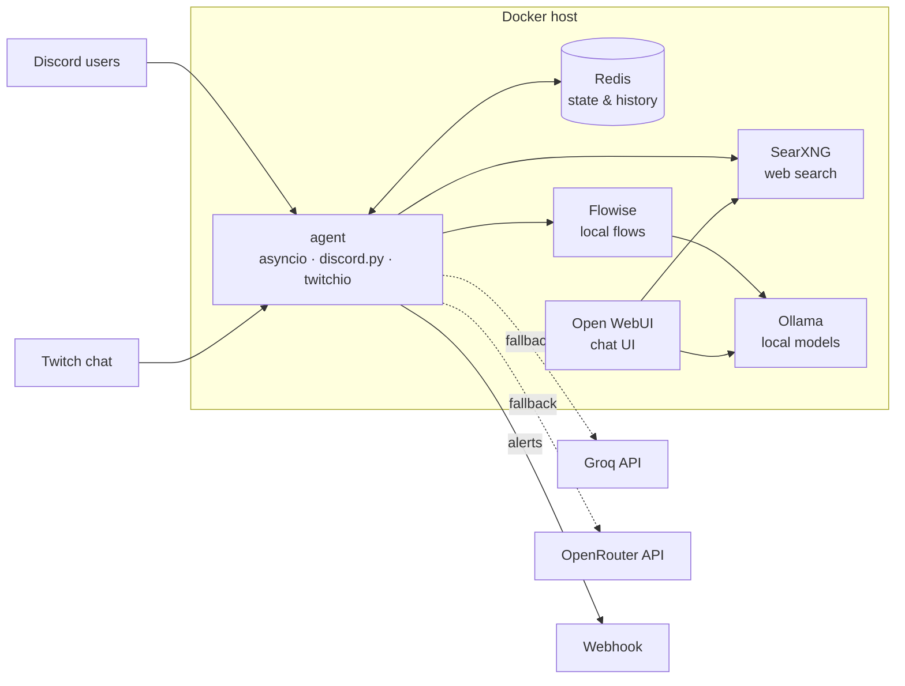

# primiBOT

A PT-PT AI chat bot for **Discord** and **Twitch**, running on a self-hosted, local-first
LLM stack. It answers with web-grounded context, keeps per-server history and degrades
gracefully from local models to cloud APIs when something fails.

> **Note on the name:** the container and some folders are called `langchain-agent` for
> historical reasons. This project does **not** use LangChain — it is plain `asyncio` with
> `discord.py` and `twitchio`, which keeps the dependency tree small and the control flow
> explicit.

## Architecture



Request flow: a message arrives from Discord or Twitch → `ai_core` picks a provider →
local model first, cloud as fallback → the answer is optionally grounded with real search
results from SearXNG → history is trimmed and summarised in Redis.

## Features

- **Provider chain with automatic fallback** — Flowise flows (local), OpenRouter, Groq and
  a backup unit, tried in order. A failing provider degrades the answer instead of killing
  the bot.
- **Local-first**: the default path never leaves the host. Cloud APIs are only used as
  fallback, for vision models, or when latency demands it.
- **Web-grounded answers** — SearXNG results (titles + snippets) are injected into the
  prompt to reduce hallucination, instead of relying on the model's memory alone.
- **Conversation summarisation** — long histories are compressed with a cheap model, so
  context stays inside the window without losing the thread.
- **Per-server isolation** — guild/channel configuration and history are scoped, so
  multiple servers can share one process safely.
- **Guardrails** — `scope.py` and `safety.py` limit off-topic and unsafe outputs;
  prompts are platform-specific (Discord vs Twitch, different length limits).
- **Supervised services** — every loop (Discord, Twitch, heartbeat, digest) runs as a
  guarded task; a crash is logged and reported to a webhook instead of taking the bot down.
- **Real health checking** — a heartbeat file is written every 30 s and checked by the
  container healthcheck, so a stalled event loop shows up as `unhealthy` rather than as
  silent message loss.

## Stack

| Layer | Technology |
|---|---|
| Language | Python 3.11 (`asyncio`) |
| Platforms | `discord.py`, `twitchio` |
| Local inference | Ollama, Open WebUI |
| Orchestration | Flowise |
| Search / grounding | SearXNG (JSON API) |
| State & history | Redis |
| Ops | Docker, Docker Compose, Portainer, Watchtower |
| Hosting | Self-hosted home server (Linux, SMB share, SSH deploys) |

## Repository layout

| File | Responsibility |
|---|---|
| `agent.py` | Entrypoint; starts and supervises every service task |
| `ai_core.py` | Provider chain, prompt assembly, search grounding, summarisation |
| `discord_bot.py` / `twitch_bot.py` | Platform adapters and command handling |
| `guild_config.py` | Per-server configuration and unit isolation |
| `scope.py` / `safety.py` | Domain and content guardrails |
| `storage.py` / `state.py` | Persistence and shared async clients |
| `notify.py` | Heartbeat, webhook alerts, daily digest |
| `twitch_api.py` | Twitch EventSub / API loops |
| `migrate_units.py` | One-off data migration between storage layouts |

## Running it

```bash
cp .env.example .env      # fill in your own tokens and keys
docker compose -f compose.example.yml up -d
docker logs -f langchain-agent
```

The bot exposes no HTTP port — it is a pure client. It needs Redis, SearXNG and Flowise
reachable on the same Docker network; without them it cannot start.

A minimal, sanitised compose file lives in [`compose.example.yml`](compose.example.yml).

## Configuration

All configuration is environment-based (`config.py`). See `.env.example` for the full list:

- `DISCORD_TOKEN`, `TWITCH_TOKEN`, `TWITCH_CLIENT_ID` / `SECRET` — platform credentials
- `GROQ_API_KEY`, `OPENROUTER_API_KEY` — optional cloud fallbacks
- `FLOW_ID` / `FLOW_ID_PI` — Flowise chatflow identifiers
- `SEARXNG_URL`, `REDIS_URL` — internal service URLs
- `WEBHOOK_URL` — crash and digest notifications

Never commit `.env`. It is git-ignored by default.

## Design decisions

**Why local-first?** Cost control and privacy: chat traffic stays on the host, and cloud
models are a fallback rather than the default. It also keeps the bot usable when the
upstream API is down or rate-limited.

**Why a provider chain instead of one API?** Availability. Local models handle volume;
cloud models cover vision and hard questions. Each provider has a health signal, so a
dead endpoint is skipped instead of retried forever.

**Why no LangChain?** The logic is a handful of async calls and one loop; a framework
would add indirection and dependencies without removing any real complexity.

**Why a heartbeat file?** Docker's default healthcheck only knows the process is alive.
A stalled `asyncio` loop keeps the process alive while answering nothing — the heartbeat
catches exactly that case.

## Security notes

This repo is a sanitised portfolio copy. The running instance uses a private network and
secrets injected at deploy time; no credentials, private IPs or host paths are published
here.

Hardening still on the list:

- [ ] Authentication and TLS on the internal UIs (Open WebUI, Flowise)
- [ ] Secrets from a manager instead of a plain `.env`
- [ ] Network policies / firewall rules between the bot and the AI services
- [ ] Least-privilege tokens for Discord and Twitch
- [ ] Audit log for prompt/response pairs with PII redaction

## Known limitations

- **No automated tests or CI** — the largest gap. The provider chain and guardrails are
  prime candidates for unit tests with mocked HTTP clients.
- Provider health is inferred from request outcomes, not from active probing.
- Single-host deployment; no horizontal scaling (state is in Redis, but the bot is one
  process by design).

## Roadmap

1. Test suite for `ai_core` (provider selection, fallback, grounding) and `scope`.
2. GitHub Actions: lint + tests on push.
3. Structured metrics (latency per provider, fallback rate) with a small dashboard.
4. RAG over local documents, not just web search.

## How this was built

Developed iteratively with AI-assisted coding (LLM assistants). Architecture, module
decomposition, prompt design, deployment, debugging and review decisions are mine; the
assistants accelerated implementation and documentation.

---

Author: Sérgio Carmo · [GitHub](https://github.com/primituga) · [LinkedIn](https://www.linkedin.com/in/s%C3%A9rgio-carmo-9b640ba0/)
